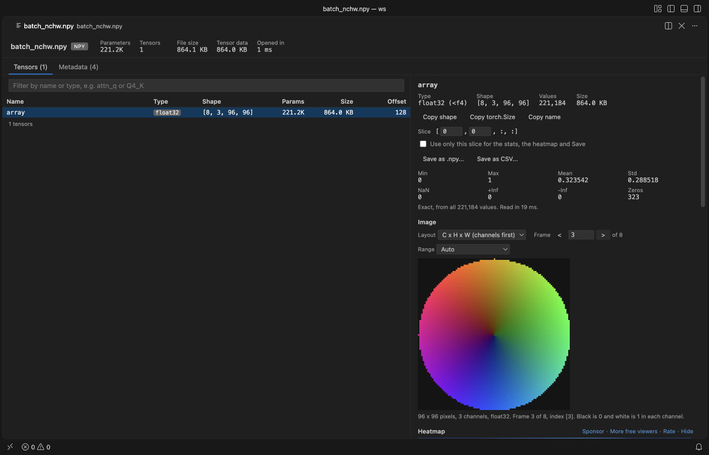
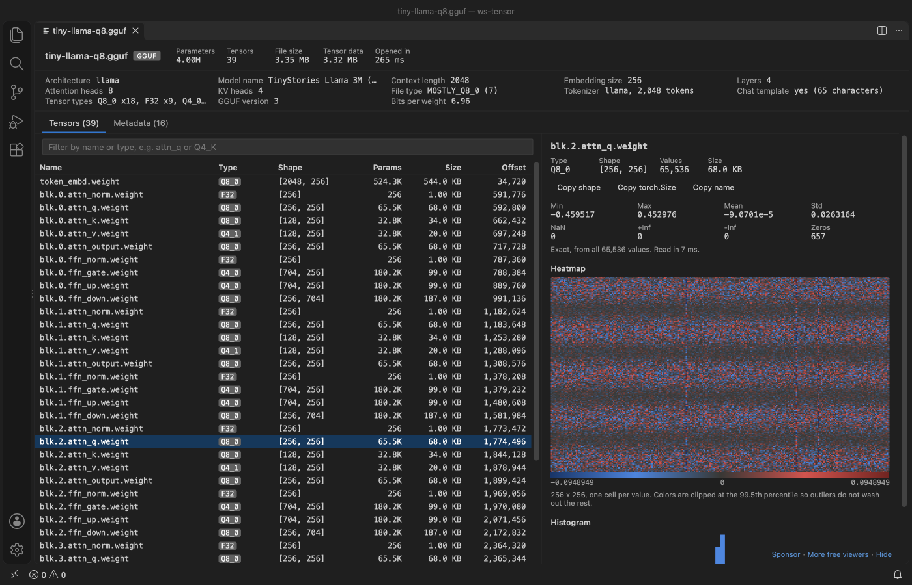
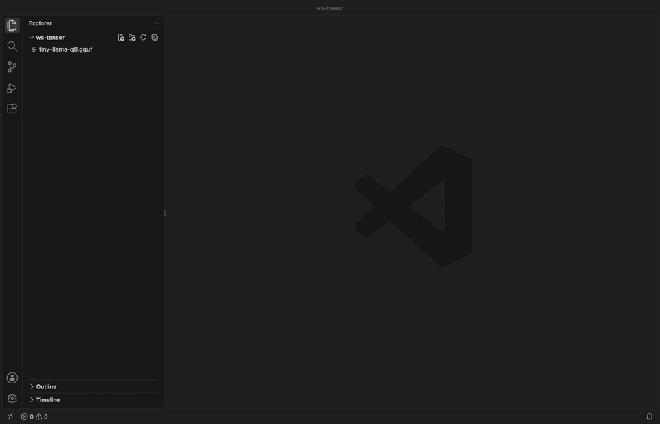
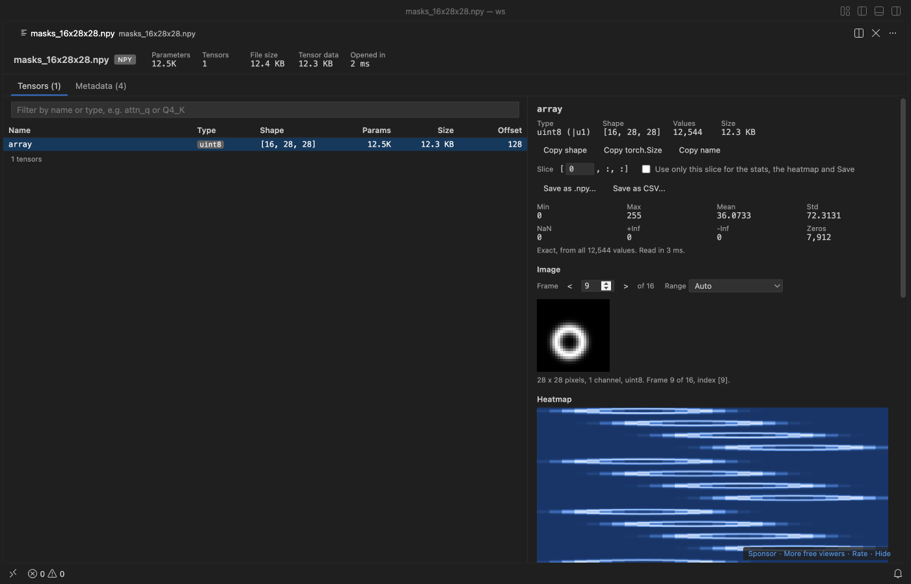
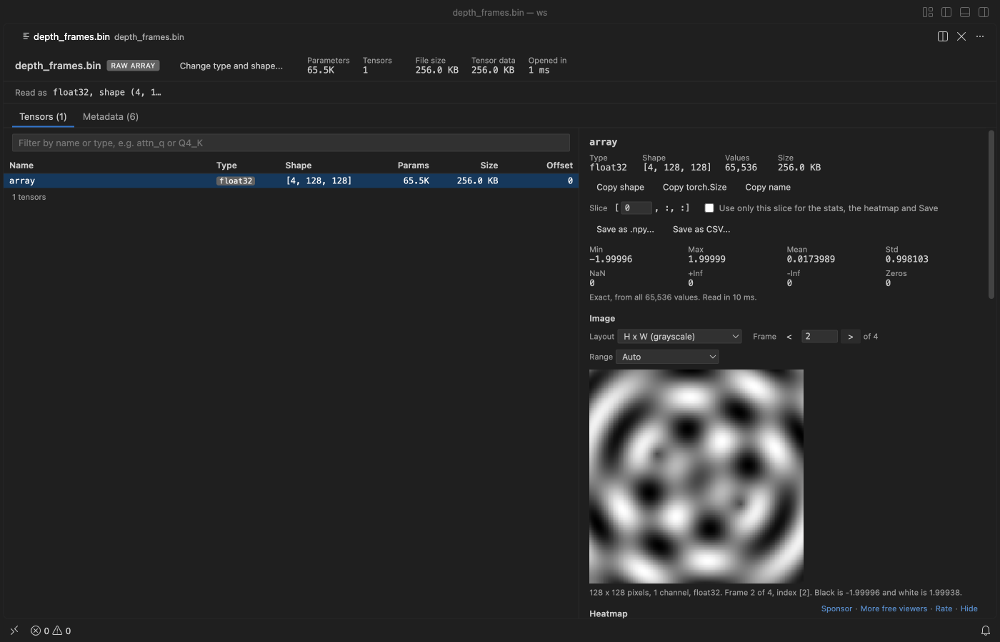
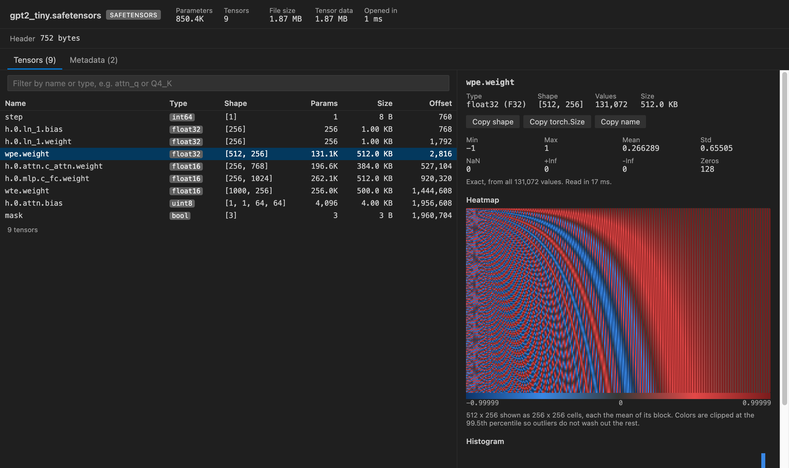
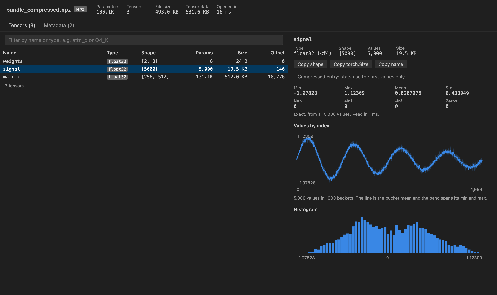
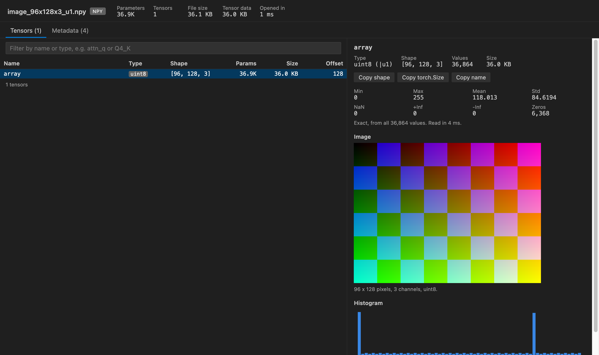

# NPZ & NPY Viewer, GGUF & Safetensors (NumPy Viewer)

Tensor Viewer is an NPZ and NPY viewer for NumPy arrays that also opens `.gguf` and `.safetensors` model files. It shows every array's name, dtype and shape, plus stats, a heatmap and the values, without Python.

New in 0.3.0:

- Arrays as pictures: any array shaped like an image is drawn as one. That covers `(H, W)`, `(H, W, 3)` and PyTorch-style `(3, H, W)`, plus whole stacks and batches such as `(N, H, W)` or `(N, 3, H, W)`. Pick the layout, step through frames, and choose the value range (0 to 1, 0 to 255, min to max or symmetric).
- Raw `.bin` arrays: files written by `ndarray.tofile()` have no header. Right-click one and pick "Open as Raw Array...", then give the dtype and shape (`-1` fills in from the file size). You get the same stats, pictures and values table, and Save as .npy turns it into a real `.npy` file.

*A real VS Code 1.142 window running this extension on [`test/fixtures/tiny-llama-q8.gguf`](https://github.com/theluckystrike/tensor-viewer-vscode/blob/main/test/fixtures/tiny-llama-q8.gguf), a 3.35 MB llama-style GGUF written by gguf-py from `scripts/make-fixtures.py`.*

- It opens big checkpoints in well under a second and shows the real numbers. Only the header is read at first, and a click on a tensor reads that tensor's bytes by offset. Our test opens a 10.7 GB safetensors file in under 1 s. The Values table pages through any tensor, one 2-D slice at a time, and Save writes a tensor or a slice to .npy or CSV.
- It reads the formats local LLM users actually have. GGUF metadata (architecture, context length, file type, tokenizer, chat template) sits next to the quant type of each tensor. Q8_0, Q4_0, Q4_1, Q5_0, Q5_1, Q4_K, Q5_K and Q6_K weights are decoded for stats and heatmaps.
- It draws arrays as pictures and reads raw binary dumps (see above), which the other NumPy viewers in the Marketplace don't do together.
- It's safe to open files you downloaded. Nothing in the file is ever run. Pickled object arrays in `.npy` and `.npz` are listed and refused, and the viewer makes no network calls at all.

## Quick start

1. Install Tensor Viewer.
2. Click any `.gguf`, `.safetensors`, `.npy` or `.npz` file in the Explorer. Then click a tensor in the table.

*Recorded in the same window. The white arrow is drawn in to show where each click lands.*

Run "Tensor Viewer: Get Started" from the Command Palette for a short tour.

## What you see

The top bar shows the total parameter count, the number of tensors, the file size and how long the header took. GGUF files add a summary row with the architecture, model name, context length, embedding size, layers, heads, file type, tokenizer size and bits per weight.

The tensor table lists name, type, shape, parameter count, size in bytes and byte offset. Type in the filter box to match names (`attn_q`, `blk.3.`) or an exact type (`Q4_K`, `float16`). Click a header to sort. Up and down arrows move through the list. Tables with thousands of tensors show 500 rows at a time.

Click a tensor and the right panel shows min, max, mean, std, NaN, +Inf, -Inf and zero counts. 2-D tensors get a heatmap. 1-D tensors get a line plot with a min and max band, and an HxWx3 uint8 array shows as a picture. A histogram comes last. Hover over any of them to read exact values. "Copy shape" puts `(4096, 11008)` on the clipboard, and "Copy torch.Size" gives `torch.Size([4096, 11008])`.

### Values table

Under the heatmap, the Values table shows the numbers themselves, 32 rows at a time. Use the arrow buttons to page through rows and columns, or type a row or column number and press Enter. The number format can be Auto, Exact, 2, 4 or 8 decimals, or Scientific. Hover over a cell to see its index and its exact value. "Copy values" puts the page on the clipboard as tab-separated text, which pastes into a spreadsheet.

GGUF quant types such as Q4_K and Q8_0 show their values after dequantizing, as llama.cpp computes them. float16, bfloat16 and FP8 values show as their exact float32 value. Complex numbers show as `3+4j`.

For tensors with 3 or more dimensions, the Slice field picks one 2-D slice, for example `[5, :, :]` for the sixth image in a batch. The table shows that slice. Tick "Use only this slice for the stats, the heatmap and Save" and the stats, the heatmap and the Save buttons use it too.

### Images, stacks and batches

When an array can be a picture, an Image section shows under the stats. RGB and RGBA layouts and uint8 arrays draw at once. Float matrices get a "Show as image" button, because a weight matrix is usually easier to read as a heatmap.

- Layout: the viewer offers every layout the shape allows and picks the likely one first. `(H, W, 3)` and `(H, W, 4)` are channels last, `(3, H, W)` is channels first, and anything else is grayscale.
- Frame: leading dimensions are frames, so a `(16, 28, 28)` stack of masks or an `(8, 3, 96, 96)` batch shows one picture at a time. Use the arrow buttons, or type a frame number and press Enter. The caption gives the index of each dimension.
- Range: Auto uses 0 to 255 for uint8, 0 to 1 for floats that stay in that range, and min to max otherwise. You can also pick a fixed range or one symmetric around 0. NaN and Inf pixels show in magenta in grayscale pictures.

Only the rows the picture needs are read, so frame 9,000 of a large stack opens as fast as frame 0.

### Raw binary arrays (.bin, .raw, .dat)

`ndarray.tofile()`, `array.array.tofile()` and many C programs write bare values with no header. To open one, right-click the file in the Explorer and pick "Open as Raw Array...". You can also run "Tensor Viewer: Open as Raw Array..." from the Command Palette. Then answer four short prompts:

1. Value type: float32, float64, float16, bfloat16, int8 to int64, uint8 to uint64, complex64, complex128 or bool. Each choice shows how many values the file holds.
2. Header bytes to skip (0 for `tofile()`).
3. Shape, such as `4, 128, 128`. Use `-1` once to fill in from the file size, or leave it empty for one long 1-D array. A shape that doesn't fit the file is caught before it opens.
4. Byte order, for types bigger than 1 byte.

The layout is remembered for each file in the workspace, and "Change type and shape..." at the top changes it. The Metadata tab shows the matching `np.fromfile(...)` line. `.bin`, `.raw` and `.dat` also show Tensor Viewer under "Reopen Editor With...", and it never becomes the default editor for them.

### Save as .npy or CSV

"Save as .npy..." writes the tensor (or the slice) to a NumPy file that `np.load` reads. Types NumPy has, such as float32, int64 or complex64, are copied byte for byte. bfloat16, FP8 and the GGUF quant types are written as float32. "Save as CSV..." writes one row per line with every digit kept. 3-D and bigger tensors become rows of their last dimension. You pick the file in a save dialog, the file is written in chunks with a progress bar you can cancel, and Tensor Viewer never writes over the file it is showing.

The heatmap uses blue for negative values and red for positive ones, with gray at zero. Data that's never negative uses a single blue ramp instead. Colors are clipped at the 99.5th percentile so a few outlier weights don't flatten everything else, and the caption says when that happened.

## Supported files

| Format | What is read | Types decoded for stats |
|---|---|---|
| `.npy` | header v1, v2 and v3, C and Fortran order, either byte order | bool, int8 to int64, uint8 to uint64, float16/32/64, complex (as magnitude), datetime as raw ticks |
| `.npz` | zip directory, stored and deflated entries, zip64 | same as `.npy` |
| `.safetensors` | JSON header and `__metadata__` | BOOL, U8, I8, I16, U16, I32, U32, I64, U64, F16, BF16, F32, F64, F8_E4M3, F8_E5M2 |
| `.gguf` | v1 to v3 metadata and tensor info, through @huggingface/gguf | F32, F16, BF16, F64, I8 to I64, Q8_0, Q4_0, Q4_1, Q5_0, Q5_1, Q4_K, Q5_K, Q6_K |
| raw (`.bin`, `.raw`, `.dat`, any file) | the type, shape, header size and byte order you give | all of the `.npy` types except text and structured |

Other GGUF types (Q2_K, Q3_K, IQ types, TQ, MXFP4) are listed with the right size and offset, but have no stats yet. Text, structured and object arrays in NumPy files are listed without stats.

The GGUF shapes are shown in row-major order, the way PyTorch prints them. GGUF itself stores the dimensions fastest-first, so `[4096, 32000]` in llama.cpp logs is `[32000, 4096]` here.

## How big files stay fast

Tensor Viewer never reads a whole file. The `.npy` and safetensors headers are a few hundred bytes to a few MB, and GGUF metadata is read in 2 MB steps until the tensor list ends. For one tensor it reads at most `tensorViewer.sampleValues` values (2,000,000 by default). When a tensor is bigger, it reads up to 512 runs of whole rows spread evenly from the first row to the last, so the heatmap covers the full tensor. The panel always says whether the stats are exact or from a sample, and how many values went in.

Deflated `.npz` entries can't be read at an offset. For those, the header comes from inflating just the start of the entry, and big arrays are sampled from their first rows.

| Setting | Default | What it does |
|---|---|---|
| `tensorViewer.sampleValues` | 2,000,000 | Most values read from one tensor for stats and plots |
| `tensorViewer.maxRemoteFileMB` | 512 | Files not on local disk are read whole, up to this size |
| `tensorViewer.askForRating` | true | Ask one time for a Marketplace rating, after 5 files and 2 days. Turn it off with `false` |

The Values table reads only the cells on the page, so a page of a 10 GB tensor costs a few KB.

## Privacy and safety

There's no telemetry and no network access. The webview runs under a strict Content-Security-Policy with no remote scripts, and every name and metadata string is drawn as text, never as HTML. Python pickle is never loaded, so `.pt`, `.pth`, `.pkl` and object arrays inside `.npy` files stay closed. Tensor Viewer never changes the file it shows. Save as .npy and Save as CSV write only to a new file that you pick.

## Limits

Pictures are drawn at most 512 pixels on the long side, with nearest-neighbor scaling. 2-channel arrays and Fortran-order arrays have no picture view. Pictures from compressed `.npz` entries are limited to frames in the first 64 MB of the entry. Raw files can't be detected by themselves, so a wrong type or shape shows wrong numbers, not an error.

GGUF files split into shards show the tensors of the open shard only, with a note. Heatmaps show at most 256 by 256 cells, each the mean of its block of values. Tensors with three or more dimensions are drawn with the leading dimensions flattened into rows, unless you tick "Use only this slice". Slices of Fortran-order arrays show in the Values table, but the stats and heatmap cover the whole array. CSV export stops at 20 million values; use .npy for bigger tensors. Compressed `.npz` entries can only be read from the start, so values past their first 64 MB are not shown, and entries over 512 MB can't be saved. 64-bit integers above 2^53 lose their last digits in the table and in CSV. The .npy export copies them exactly.

## License

MIT. Bundled libraries are listed in THIRD-PARTY-NOTICES.md (@huggingface/gguf, @huggingface/tasks and fflate, all MIT).

## Support Zovo

Zovo extensions are free, with no ads and no tracking. They are made by [theluckystrike](https://github.com/theluckystrike) on GitHub. If this one saves you time, you can support the work:

- [Sponsor on GitHub](https://github.com/sponsors/theluckystrike)
- [Follow theluckystrike on GitHub](https://github.com/theluckystrike)

## More tools by Zovo

- [HDF5 & NetCDF Explorer (H5 Viewer)](https://marketplace.visualstudio.com/items?itemName=zovo.hdf5-netcdf-explorer) browses groups, attributes and values in HDF5 and NetCDF files and plots slices.
- [PKL Viewer & Pickle Viewer](https://marketplace.visualstudio.com/items?itemName=zovo.zovo-pickle-viewer) opens Python pickle files without Python and never runs their code.
- [TIFF Viewer (16-bit, Float, GeoTIFF)](https://marketplace.visualstudio.com/items?itemName=zovo.tiff-viewer) opens 16-bit, float, multi-page and GeoTIFF images.
- [CSV Viewer, Excel Viewer (XLSX) & Parquet Viewer](https://marketplace.visualstudio.com/items?itemName=zovo.table-viewer-vscode) opens CSV, TSV, Excel and Parquet files as a sortable, filterable table.

See [all Zovo extensions on the Marketplace](https://marketplace.visualstudio.com/publishers/zovo).
